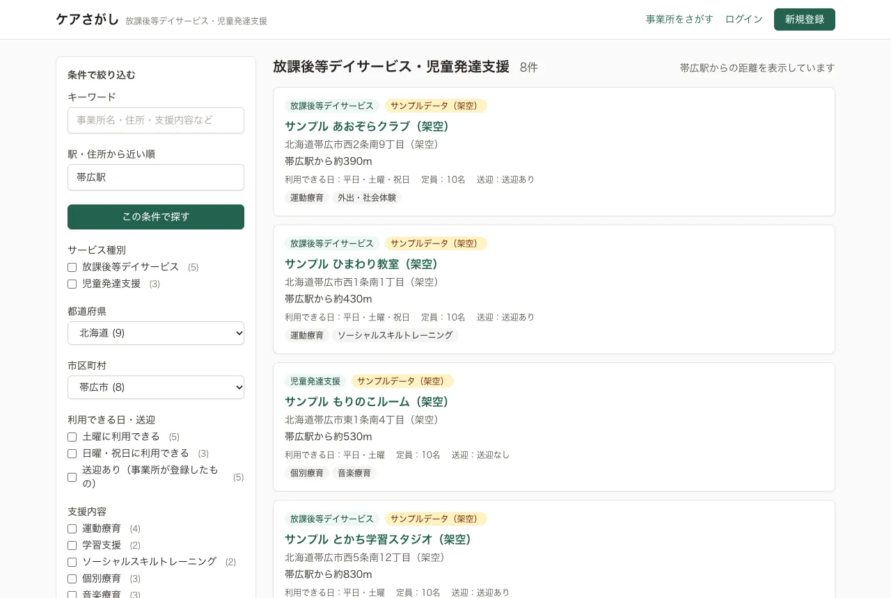
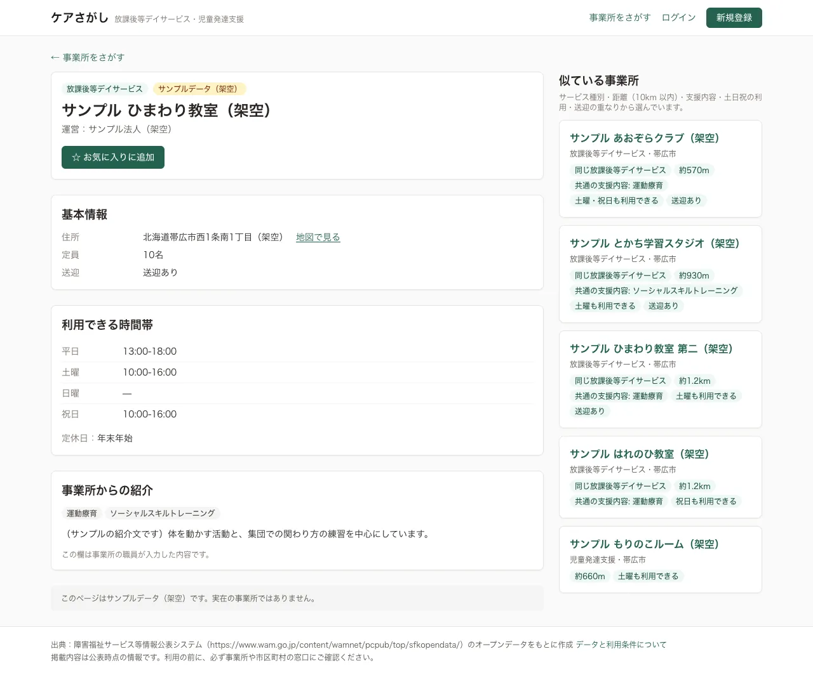
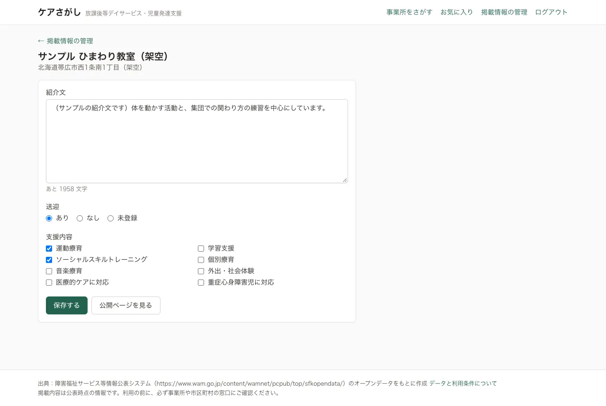
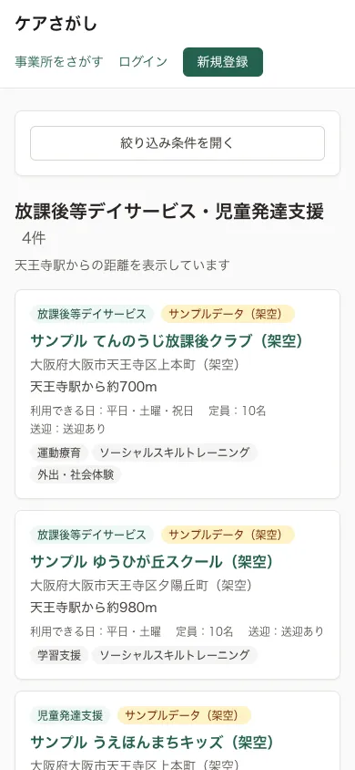
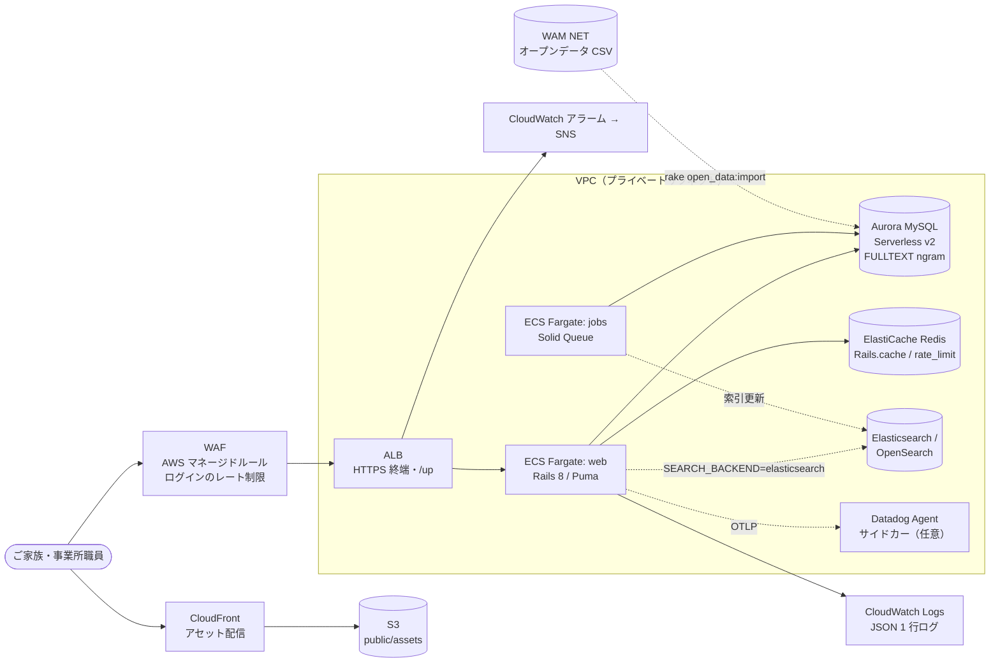
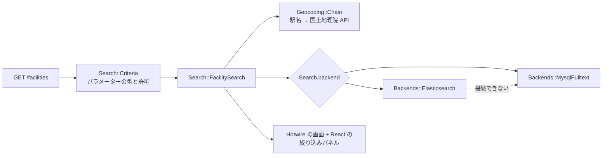

# care-finder（ケアさがし）

**English summary**: A Ruby on Rails 8 app for families looking for after-school day services (放課後等デイサービス) and child development support (児童発達支援) in Japan. It imports real public open data from the MHLW/WAM disclosure system (Hokkaido and Osaka, about 7,300 facilities), and offers faceted Japanese full-text search (MySQL FULLTEXT with the ngram parser by default, Elasticsearch behind the same interface), sorting by distance from a station, explainable "similar facilities" recommendations, favourites for signed-in families, and an admin area where facility staff can edit only their own listing. Hotwire for most pages, plus one React + TypeScript island. Tested with RSpec (models, requests, system), Jest and Playwright. AWS infrastructure (ALB + WAF, ECS Fargate, Aurora MySQL Serverless v2, ElastiCache, S3 + CloudFront, CloudWatch alarms) is written in Terraform; it passes `terraform validate` and `tflint` but has never been applied.

---

障害のあるお子さん向けの放課後等デイサービス・児童発達支援を、地域・曜日・送迎・支援内容でさがすための Web アプリです。障害福祉サービス等情報公表システムのオープンデータ（北海道・大阪府の約 7,300 事業所）を取り込んで動かしています。

筆者は SRE / バックエンドエンジニアで、北海道と大阪で放課後等デイサービスを運営しています。事業所選びでよく条件になる「近さ」「土曜・祝日に通えるか」「送迎」を軸に、検索と推薦を組み立てました。

## 画面

| 検索（帯広駅から近い順） | 事業所の詳細と「似ている事業所」 |
|---|---|
|  |  |

| 管理画面（職員が自分の事業所だけを編集） | スマートフォン幅 |
|---|---|
|  |  |

スクリーンショットは、シードの「サンプルデータ（架空）」だけを入れた開発環境を Playwright で撮ったものです（`e2e/screenshots.spec.ts`）。写っている事業所名・住所・法人名はすべて架空で、実在の事業所ではありません。

## できること

- **検索**: キーワード（事業所名・法人名・住所・紹介文・支援内容）、都道府県・市区町村、サービス種別、土曜／日曜・祝日の利用、送迎、支援内容で絞り込み。条件ごとの件数を表示
  - 全角／半角、ひらがな／カタカナ、住所のダッシュの違いを吸収（`Search::TextNormalizer`）
  - 駅名（または住所）を入れると近い順に並べ、距離を表示
- **似ている事業所**: サービス種別・距離・支援内容・土日祝の利用・送迎の重なりで選び、理由（「同じ放課後等デイサービス」「約1.2km」「土曜も利用できる」など）を添える
- **お気に入り**: 家族が登録・ログインして保存（Turbo Stream でボタンだけ切り替え）
- **管理画面**: 事業所の職員が、担当する事業所の紹介文・送迎・支援内容だけを編集。担当外の事業所は 404
- **認証**: Rails 8 の認証ジェネレーター。ログイン・登録・パスワード再設定に回数制限（`rate_limit`）

## 構成



アプリの中の流れ:



| 場所 | 役割 |
|---|---|
| `app/models/search/criteria.rb` | 検索条件のフォームオブジェクト。Rails と React で同じ形を使う |
| `app/services/search/` | 正規化、検索のユースケース、MySQL / Elasticsearch のバックエンド |
| `app/services/recommendations/similar_facilities.rb` | 似ている事業所と理由 |
| `app/services/geocoding/` | 駅名の代表点（`config/stations.yml`）と国土地理院の住所検索 API |
| `app/services/open_data/wamnet/` | オープンデータの取得・変換・upsert |
| `app/controllers/admin/` | 職員向け画面（担当事業所への絞り込み） |
| `app/javascript/islands/` | React の島（絞り込みパネル）と、その載せ方 |
| `infra/terraform/` | AWS 一式 |

## 設計の判断

- [ADR 0001: 検索は MySQL FULLTEXT（ngram）を既定にし、Elasticsearch は差し替え可能にする](docs/adr/0001-search-backend.md)
- [ADR 0002: 「似ている事業所」は内容ベースの点数で選び、理由を表示する](docs/adr/0002-recommendation.md)
- [ADR 0003: キャッシュは ElastiCache Redis、ジョブは Solid Queue（Aurora）にする](docs/adr/0003-cache-and-queue.md)
- [ADR 0004: 画面は Hotwire で作り、絞り込みパネルだけを React の島にする](docs/adr/0004-hotwire-and-react-island.md)
- [ADR 0005: 事業所データは WAM NET のオープンデータを使い、職員が入力する項目と分ける](docs/adr/0005-open-data.md)
- [SLO と劣化時の動き](docs/slo.md)

## データの出典と利用条件

- 出典: 障害福祉サービス等情報公表システム（独立行政法人福祉医療機構）のオープンデータ
  https://www.wam.go.jp/content/wamnet/pcpub/top/sfkopendata/
- 対象: 放課後等デイサービス（65）・児童発達支援（63）、2026 年 3 月末時点、北海道と大阪府の事業所
- 利用条件: 公共データ利用規約（第1.0版）。このアプリでは都道府県での抽出、住所の分割、改行記号の復元などの加工をしています
- データファイルはリポジトリに含めず、`bin/rails open_data:import` で取得します。テスト用のフィクスチャ（`spec/fixtures/files/wamnet/`）は同じ形式の**架空のデータ**です
- 紹介文・送迎・支援内容はオープンデータにないため、事業所の職員が入力したものだけを表示します。口コミや利用者の声は扱いません

## 手元で動かす

必要なもの: Ruby 4.0.9（`.ruby-version`）、Node.js 24.22.1（`.node-version`）、Docker

```sh
docker compose up -d                 # MySQL 8.0（3307 番）と Redis（6380 番）
bin/setup --skip-server              # bundle install、npm ci、DB 作成、シード投入
bin/rails open_data:import           # WAM NET から北海道・大阪府の事業所を取り込む
bin/dev                              # http://localhost:3000
```

- 取り込む地域や時点は `SNAPSHOT=202603 PREFECTURES=北海道,大阪府` で変えられます
- デモ用アカウント（開発・テスト環境だけ、`db/seeds.rb`）: `family@example.com`（家族）、`staff@example.com`（サンプル事業所の職員）。パスワードは `demo-password-2026`
- Elasticsearch で動かす場合:

  ```sh
  docker compose --profile search up -d
  SEARCH_BACKEND=elasticsearch ES_URL=http://127.0.0.1:9201 bin/rails search:reindex
  SEARCH_BACKEND=elasticsearch ES_URL=http://127.0.0.1:9201 bin/dev
  ```

- 住所での距離検索（国土地理院 API）を使う場合は `GEOCODER_GSI_ENABLED=1`。既定は `config/stations.yml` の駅名だけで、外部 API を呼びません

## テストと検査

```sh
bundle exec rspec                    # モデル・サービス・リクエスト・システムテスト。app/ の行カバレッジ 90% 未満で失敗
ES_URL=http://127.0.0.1:9201 REDIS_URL=redis://127.0.0.1:6380/0 bundle exec rspec
                                     # Elasticsearch の契約テストと Redis の統合テストも流す
npm test                             # Jest（React の絞り込みパネル）
npm run lint && npm run typecheck    # ESLint / tsc
npx playwright test --project smoke  # E2E: 検索 → 詳細 → ログイン → お気に入り（test 環境の Rails を自動で起動）
npm run storybook                    # 絞り込みパネルのストーリー
bin/rubocop && bin/brakeman && bin/bundler-audit
bin/ci                               # 上の検査をまとめて流す
```

テストの方針:

- 検索バックエンドは共通の契約テスト（`spec/support/shared_examples/search_backend.rb`）を MySQL と Elasticsearch の両方に流す
- 全文検索を通すテストは、InnoDB の FULLTEXT がコミット時に更新されるため、トランザクションを使わずに後片付けする（`:committed_data`）
- 外部 HTTP は WebMock で止め、WAM NET と国土地理院 API はスタブで確かめる
- 担当外の事業所を編集できないこと（404）、公開データの項目を送っても変わらないことをリクエストスペックで確かめる

## インフラ（infra/terraform）

ALB + WAF（AWS マネージドルール、ログインのレート制限）、ECS Fargate（web と jobs の 2 サービス、デプロイ失敗時の自動ロールバック、CPU でのオートスケール）、Aurora MySQL Serverless v2（ngram_token_size=2、TLS 必須、マスターパスワードは RDS 管理）、ElastiCache Redis（暗号化・Multi-AZ）、S3 + CloudFront（アセット）、CloudWatch アラーム（SLO に合わせた 5xx 割合と p95）を定義しています。

```sh
cd infra/terraform
terraform init -backend=false && terraform validate && tflint --init && tflint
```

**`terraform apply` は一度もしていません。** 認証情報も設定していません。マイグレーションは Web タスクの起動時ではなく、単発の ECS タスク（`terraform output migration_command`）で流す想定です。

## 意図して入れていないもの

- 本番へのデプロイとデプロイ用のワークフロー（イメージのビルドまでを CI で確かめています）
- 事業所の職員アカウントの発行画面（今は運営者がコンソールで所属を作る想定）
- 口コミ・評価・空き状況。根拠のある情報源がないため
- 全国のデータの取り込み（rake タスクの引数で可能ですが、動作確認は北海道・大阪府だけ）
- 地図の埋め込み（外部のタイル配信に CSP を開けないため、OpenStreetMap へのリンクにしています）
- 利用履歴を使った推薦（[ADR 0002](docs/adr/0002-recommendation.md)）
